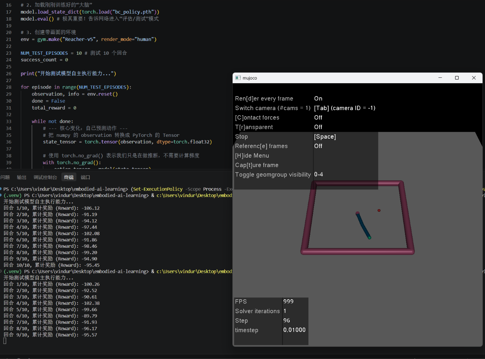
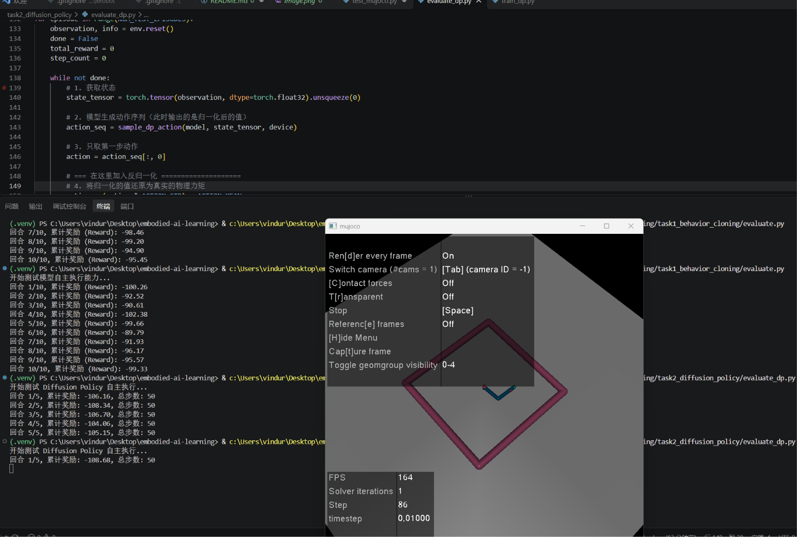
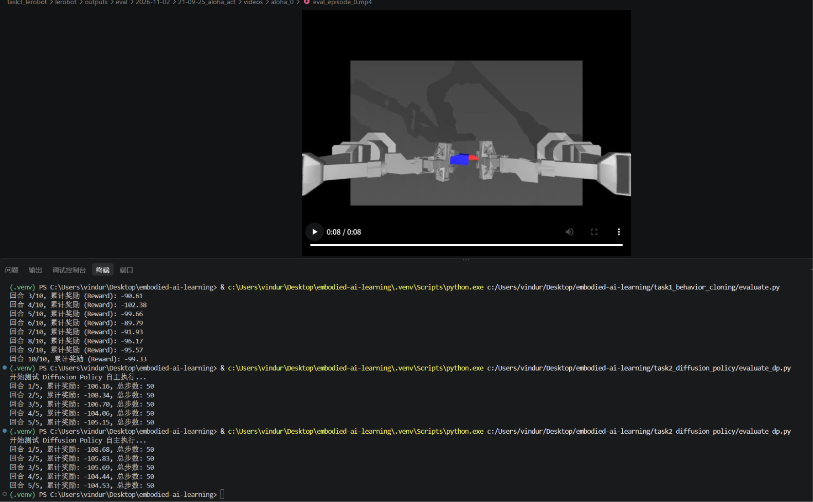

# 具身智能学习路线复现：从行为克隆到 LeRobot

本项目是针对 [赵鸣博/Mbot Lab(stage2模仿学习)] 学习路线的完整复现。通过从零手写算法，到使用工业级框架，完整走通了具身智能的入门闭环。

## 🎯 核心收获
1. **底层原理**：手写 MLP 与 DDPM 1D U-Net，深刻理解了监督学习的分布偏移（Distribution Shift）与扩散模型的条件坍塌。

2. **工程能力**：跨越 Python 3.12 环境冲突，掌握 `uv` 包管理，成功在 Windows/CPU 环境下跑通 LeRobot 框架。

3. **前沿框架**：成功加载 ALOHA 数据集，迁移并评估了官方 ACT（Action Chunking with Transformer）模型，渲染出双臂插拔任务。

## 📂 项目结构
- `task1_behavior_cloning/`：手写行为克隆（BC），成功记录训练日志，并在分析中发现了典型的复合误差雪崩现象。

- `task2_diffusion_policy/`：手写条件扩散策略（Diffusion Policy），成功实现 1D U-Net 去噪，Loss 收敛至 0.017。

- `task3_lerobot/`：基于 LeRobot 框架的 ACT 策略复现，包含模型迁移排错记录及仿真评估视频（截图）。

## 🖼️ 实验结果展示
- **Task 1**：

- **Task 2**：

- **Task 3**：

## ⚠️ 关于模型权重
为了避免仓库过大，训练生成的 `.pth` 权重和 `.mp4` 视频未上传。Task 3 评估使用的是官方预训练模型。